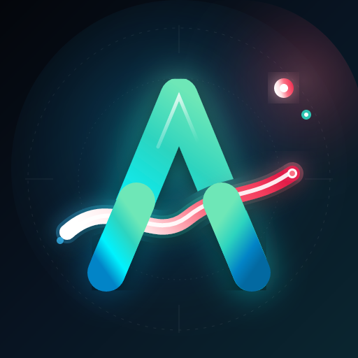

# Anyflow

**Аниме, манга и ранобэ в одном приложении**

Русская озвучка и японская с субтитрами · манга и ранобэ · «Смотреть вместе» · Anime4K · синхронизация между устройствами

 

---

## ✨ Что умеет

| | |
|---|---|
| 🎬 **Аниме** | Тысячи тайтлов с русской озвучкой от разных студий и оригинал на японском с субтитрами. Пропуск опенингов и эндингов, автопереход, филлеры, торренты в максимальном качестве |
| 📚 **Манга** | Удобная читалка, переводы на русский и английский, полка с закладками и прочитанными главами |
| 📖 **Ранобэ** | Читалка лёгких новелл и озвучка текста голосом |
| 👥 **Смотреть вместе** | Комната по коду или ссылке: пауза, перемотка и серии у всех одновременно, чат и реакции |
| 🪄 **Anime4K** | Апскейл прямо на видеокарте: чёткие линии и 2K/4K из любого видео |
| ☁️ **Синхронизация** | История, позиция в серии, списки и статистика одинаковые на ПК, телефоне и iPad |
| 🏆 **Достижения и топы** | Опыт, уровни, серии дней, рейтинги игроков и уникальные темы оформления за достижения |
| 💬 **Сообщество** | Профили, комментарии, оценки, Discord-статус «Смотрит Anyflow» |
| 🌍 **Три языка** | Русский, українська, English |

## 📥 Установка

<b>🪟 Windows</b>

1. Скачайте установщик со страницы [последней версии](https://github.com/vanaedynak/AniPlayer/releases/latest) (`Anyflow-Desktop-Setup-….exe`).
2. Запустите его. Если Windows покажет «Система Windows защитила ваш компьютер», нажмите **Подробнее → Выполнить в любом случае**: так Windows встречает любые новые программы без платной подписи.
3. Дальше приложение обновляется само.

<b>🤖 Android</b>

1. Скачайте [Anyflow.apk](https://github.com/vanaedynak/AniPlayer/releases/latest/download/Anyflow.apk).
2. Откройте файл и разрешите установку из этого источника, если телефон спросит.
3. О новой версии приложение скажет само.

<b>🍎 iPad и iPhone</b>

1. Скачайте [Anyflow.ipa](https://github.com/vanaedynak/AniPlayer/releases/latest/download/Anyflow.ipa).
2. Установите через [Sideloadly](https://sideloadly.io/) или [AltStore](https://altstore.io/) со своим Apple ID.
3. С бесплатным Apple ID приложение нужно переподписывать раз в 7 дней (AltStore делает это сам).

<b>🌐 В браузере</b>

Ничего не нужно ставить: [открыть Anyflow](https://vanaedynak.github.io/AniPlayer/app/). Часть функций (торренты, Discord-статус) есть только в приложении для Windows.

## ⭐ Anyflow PRO

Базовые возможности бесплатны. PRO открывает апскейл Anime4K и свои комнаты «Смотреть вместе» (друзьям, которых вы позвали, PRO не нужен). Оформляется в приложении: значок ⭐ сверху.

## ❓ Вопросы

**Это безопасно?** Каждая версия собирается автоматически на серверах GitHub, файлы лежат в [релизах](https://github.com/vanaedynak/AniPlayer/releases) этого репозитория.

**Где исходный код?** Код закрыт. Этот репозиторий только для скачивания и обновлений.

**Нашли ошибку или есть идея?** Напишите в техподдержку: ссылка есть в приложении, «Настройки → Техподдержка».

---

© 2026 vanaedynak. Все права защищены. Anyflow — неофициальный клиент; видео, манга и тексты принадлежат их правообладателям и показываются с открытых источников.

